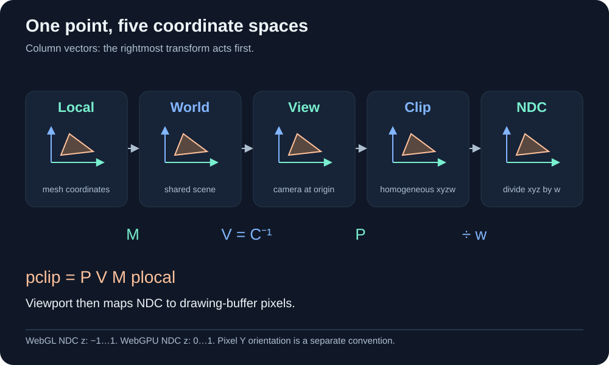

# Pixels, coordinates, and the drawing surface

A number such as `120` does not identify a place until you say what it measures and where measurement begins. A **coordinate system** supplies an origin, axis directions, and units. Graphics bugs often come from mixing coordinate systems rather than from difficult mathematics.

**Experiment:** [Pixel microscope](#/lab/pixels). **Reading bridge:** Eck §§1.1, 2.1 and 2.6; [resizing a canvas](https://webglfundamentals.org/webgl/lessons/webgl-resizing-the-canvas.html).

## An image is a rectangular array

For an image of width $W$ and height $H$, an integer pixel index is $(i,j)$, where $0\le i<W$ and $0\le j<H$. A pixel occupies an area. Its common sample location is its center, $(i+\tfrac12,j+\tfrac12)$. Sampling is evaluating a continuous function at discrete positions. It does not mean the object itself is made of squares.


## Read the inside test geometrically

The circle test uses a squared distance. Draw a horizontal segment from the circle center to the sample's X coordinate, then a vertical segment to the sample. Those perpendicular segments and the direct center-to-sample segment form a right triangle. The squared direct distance equals the sum of the squared horizontal and vertical changes. Comparing that sum with the squared radius answers whether the direct distance is at most the radius, without calculating its square root.

Squaring also removes the sign of each change, as it should for distance: a sample three units left is as far horizontally as one three units right. Direction still matters when locating the point, but distance is nonnegative. A circle membership test deliberately discards directional sign after calculating displacement.

Suppose a circle has center $(c_x,c_y)$ and radius $r$. A sample is inside when

$$
(x-c_x)^2+(y-c_y)^2\le r^2.
$$

Squaring the horizontal and vertical distances gives the squared straight-line distance. Comparing squared distances avoids a square root. In the pixel lab, `x` and `y` are normalized to the range 0 to 1, so changing resolution does not change the circle’s relative size. The lab colors a whole cell from one center sample. Production rasterizers use more sophisticated coverage and antialiasing.

## Why a sample is usually placed at a pixel center

Imagine a four-column image covering the continuous interval from X = 0 to X = 4. Its columns occupy `[0,1]`, `[1,2]`, `[2,3]`, and `[3,4]`. Their center positions are 0.5, 1.5, 2.5, and 3.5. Sampling at the integer column index instead would place every sample at a left boundary, including one at the extreme image boundary.

For normalized sampling, divide these centers by the number of columns. The four positions become 0.125, 0.375, 0.625, and 0.875. They are evenly spaced and symmetrically arranged around 0.5. The general expression `(column + 0.5) / width` follows directly from that construction.

The pixel lab uses this expression along both axes. With resolution 24, its first sample is approximately 0.0208, not zero. The circle center is close to 0.5 and its radius defaults to 0.27. A sample at `(0.5,0.5)` would have zero distance from an exactly centered circle; a sample at `(0.8,0.5)` would have distance 0.3 and therefore lie outside a radius of 0.27. A sample at `(0.65,0.65)` has squared distance `0.15*0.15 + 0.15*0.15 = 0.045`, which is smaller than the squared radius `0.0729`, so it lies inside.

The program does not draw the mathematical circle boundary and then enlarge it. It evaluates the membership rule once per coarse cell and paints that cell. The visible staircase is the consequence of those discrete decisions. Moving the circle a tiny amount can cause a boundary sample to change sides, producing an abrupt cell-color change even though the mathematical motion is smooth.

## Turn a continuous shape into a tiny image

We can reproduce the lab's central decision without a canvas. This complete console program produces a small text picture:

```js
const resolution = 12;
const radius = 0.32;
const rows = [];
for (let row = 0; row < resolution; row++) {
  let line = '';
  for (let column = 0; column < resolution; column++) {
    const x = (column + 0.5) / resolution;
    const y = (row + 0.5) / resolution;
    const dx = x - 0.5;
    const dy = y - 0.5;
    const inside = dx * dx + dy * dy <= radius * radius;
    line += inside ? '##' : '  ';
  }
  rows.push(line);
}
console.log(rows.join('\n'));
```

The outer loop advances rows, while the inner loop advances columns. Each loop iteration chooses a sample center, measures displacement from the circle center, and applies the inside test. The double-character cell partly compensates for typical console text proportions; it is an illustration rather than a calibrated display. The important fact is that the shape's rule is separate from how we present each sample.

If you change `resolution` from 12 to 48, the program makes sixteen times as many inside decisions because both dimensions become four times larger. If you change only `radius`, the sample count remains unchanged. One parameter changes the workload; the other changes the content. This separation will become important when a shader's visual complexity and its execution count change independently.

## Keep image addresses separate from shape coordinates

A row-major image array selects a pixel record with `(row*width+column)*channels`. That expression answers where the record is stored. The normalized sample expressions answer where the record measures the shape. Changing storage layout need not change the circle, and changing the circle need not change storage layout.

This separation becomes valuable when textures, framebuffers, and GPU buffers arrive later. An address or offset is a data-location concept. A coordinate can be a geometric measurement. They are sometimes related by a simple formula, but they are not interchangeable numbers merely because both are integers or floating-point values.

## CSS size and drawing-buffer size

A canvas has two sizes. CSS controls how much layout space it occupies. Its `width` and `height` attributes control the number of pixels in the drawing buffer. Stretching a 300 × 150 buffer over a 900 × 450 CSS rectangle magnifies existing samples; it does not create detail.

The **device pixel ratio**, or DPR, is a browser-reported ratio between device and CSS pixels. A DPR of 2 suggests twice as many buffer samples along each dimension. That is four times as many pixels and roughly four times the potential fragment work. Capping DPR is often a sound performance choice.

This fragment shows the mechanism used by the labs:

```js
const rect = canvas.getBoundingClientRect();
const dpr = Math.min(window.devicePixelRatio || 1, 2);
canvas.width = Math.max(1, Math.round(rect.width * dpr));
canvas.height = Math.max(1, Math.round(rect.height * dpr));
```

`getBoundingClientRect()` returns the visible canvas rectangle in CSS pixels. Multiplying by DPR sets buffer dimensions. Assigning Canvas 2D dimensions resets context state, so do it only when dimensions change and reapply transforms as needed. In WebGL also call `gl.viewport(0, 0, canvas.width, canvas.height)`: viewport state does not update itself.

## Coordinate units are an interface contract

Consider a canvas whose CSS rectangle begins 120 pixels from the viewport's left edge and is 600 CSS pixels wide. A pointer at `clientX = 420` is 300 CSS pixels inside the canvas: `420 - 120 = 300`. Its normalized horizontal fraction is `300 / 600 = 0.5`, so its horizontal NDC is zero.

Now suppose the device pixel ratio is two. The drawing buffer might be 1200 pixels wide, but the pointer's `clientX` remains a CSS coordinate. If we divide the CSS-relative value 300 by buffer width 1200, we get 0.25 and therefore NDC -0.5, visibly to the left of the intended location. The mistake is not in the formula. It is in combining measurements with different units.

There are two correct paths. Stay in CSS units for the fraction: `300 / 600`. Or convert both numerator and denominator to buffer units: `600 / 1200`. Both give 0.5. Multiplying only one side by DPR is the error. Naming variables after their units makes that mismatch easier to see during a code review.

For a simple canvas with no border or unusual CSS transformation, this integration fragment computes a normalized pointer correctly:

```js
const rect = canvas.getBoundingClientRect();
const localCSSX = event.clientX - rect.left;
const localCSSY = event.clientY - rect.top;
const u = localCSSX / rect.width;
const v = localCSSY / rect.height;
const ndcX = 2 * u - 1;
const ndcY = 1 - 2 * v;
```

`event` and `canvas` are supplied by a pointer listener in the surrounding application. A CSS border changes the relation between the element's outer rectangle and its drawable content, while rotated CSS transforms require more careful inversion. Keep the learning canvas simple before introducing those layout complications.

## Build the coordinate conversion from ordinary arithmetic

Let us derive the pixel-to-NDC formula rather than memorize it. Suppose the drawing rectangle is 800 units wide. Dividing an X coordinate by 800 turns a distance into a fraction of the width. The left boundary gives `0 / 800 = 0`; the center gives `400 / 800 = 0.5`; the right boundary gives `800 / 800 = 1`. This first operation normalizes the coordinate into the interval from zero to one.

The GPU's horizontal convention asks for an interval from minus one to plus one. That interval is two units wide, so multiply the normalized fraction by two. We now have 0, 1, and 2 at the three reference locations. Subtracting one moves those values to -1, 0, and 1. Combining the steps gives `2 * x / width - 1`.

The vertical conversion follows the same reasoning with a reversal. In top-left coordinates, the top gives fraction zero and the bottom fraction one. We want the top to become +1 and the bottom -1. Multiplying the fraction by two gives zero through two; subtracting that value from one produces the requested reversal. This is why Y uses `1 - 2 * y / height`. It is a change of coordinate convention, not a special GPU trick.

For a point at `(600,100)` inside our 800 × 400 rectangle, the normalized fractions are `0.75` and `0.25`. Horizontal NDC is `2 * 0.75 - 1 = 0.5`. Vertical NDC is `1 - 2 * 0.25 = 0.5`. The point lies halfway from center to right and halfway from center to top. The arithmetic matches a useful visual description.

This complete console example prints several conversions:

```js
function pixelToNDC(x, y, width, height) {
  if (width <= 0 || height <= 0) {
    throw new RangeError('The drawing rectangle must have positive dimensions');
  }
  return [2 * x / width - 1, 1 - 2 * y / height];
}
for (const point of [[0, 0], [400, 200], [600, 100], [800, 400]]) {
  console.log(point, pixelToNDC(...point, 800, 400));
}
```

The last point is on the rectangle's boundary. It is not an integer pixel index inside an 800 × 400 image: the final valid column index is 799 and the final row index is 399. Coordinates describing boundaries and indices selecting stored pixels are related, but they are not identical. This distinction prevents many off-by-one errors in sampling and picking.

## Converting coordinates

Canvas 2D normally has its origin at the upper left, +X right, and +Y down. Mathematical plots often use +Y up. WebGL **normalized device coordinates**, abbreviated NDC, use X and Y from -1 to +1 inside the visible region.

To map a top-left pixel-space position $(x,y)$ into NDC:

$$
x_n=2x/W-1,\qquad y_n=1-2y/H.
$$

On an 800 × 400 surface, `(400, 200)` becomes `(0, 0)`, and `(0, 0)` becomes `(-1, 1)`. These are coordinate positions, not necessarily integer pixel indices. If starting from a sample index, include the half-pixel offset. To reverse the mapping, $x=(x_n+1)W/2$ and $y=(1-y_n)H/2$.



Pointer events report CSS positions. For a canvas-relative point, subtract the rectangle’s left and top offsets. Do not multiply by DPR before dividing by the CSS width to get NDC: those units already match. The picking lesson returns to this conversion in 3D.

## Aspect ratio

The **aspect ratio** is width divided by height. A normalized horizontal unit on an 800 × 400 image spans twice as many pixels as a normalized vertical unit. A mathematically circular object can therefore look elliptical. You can adjust the projection so equal world distances have equal displayed scale. Our raw triangle lab divides horizontal positions by the aspect ratio; Three.js incorporates it into the camera’s projection matrix.

## Choosing how a world fits into a rectangle

Suppose we want a world region six units wide and four units tall. A 900 × 600 pixel rectangle has aspect 1.5, exactly matching `6 / 4`. A uniform scale of 150 pixels per world unit fits perfectly: six times 150 is 900, and four times 150 is 600.

A 900 × 450 rectangle has aspect two. If we independently scale the same world to fill both dimensions, horizontal scale becomes 150 pixels per unit but vertical scale becomes 112.5. A world-space circle becomes a screen ellipse. Independent scaling is appropriate for stretching a decorative background, but wrong when geometric proportions matter.

To preserve proportions, choose one common scale. Using the smaller available scale gives 112.5 pixels per unit and leaves horizontal empty space. Using the larger scale fills the width but crops some height. These are the familiar contain and cover policies expressed mathematically. A camera's projection can implement an equivalent fitting choice for a 3D view.

In the raw triangle lab, X is divided by aspect before being output. On a rectangle twice as wide as it is tall, this halves horizontal NDC size; because the viewport then stretches NDC across twice as many horizontal pixels, the two effects cancel. Equal geometric distances have equal screen lengths. We will derive the general camera version later.

## Resolution, detail, and what more pixels cannot fix

Increasing resolution can make a silhouette smoother, but it does not repair an incorrect coordinate conversion, a stretched aspect ratio, or a color-space error. It also cannot add geometric detail that the model never contained. A triangle remains a triangle at a million pixels; its straight edges simply become more accurately sampled.

Antialiasing improves the representation of boundaries by estimating how much of a pixel is covered or by using additional samples and filtering. In our coarse circle lab, each cell is entirely on or off. A simple extension could test several positions within each cell, count the fraction inside, and blend foreground and background accordingly. Four inside samples out of sixteen would estimate quarter coverage. That estimate needs a color-compositing convention, which is the next chapter's subject.

The practical habit to carry forward is to separate three questions: what continuous scene or shape is described, where it is sampled, and how those samples are displayed. Once these questions are separate, changing resolution becomes an understandable quality and performance decision rather than a desperate attempt to fix any visual problem.

## Practical habits

Keep names explicit: `cssWidth`, `bufferWidth`, `worldPosition`, and `ndcPointer` communicate different units. Resize when the container changes, including a sidebar or panel resize. Avoid allocating an enormous buffer for a tiny preview. Never divide by a zero height when a hidden canvas is being laid out.

**Optional application:** modify the pixel lab so the circle center follows a pointer in normalized coordinates. Reuse the coordinate conversion above; keep the shape independent of the drawing resolution. The expected result is a coarse circle that moves smoothly even though its silhouette changes one sample at a time.
