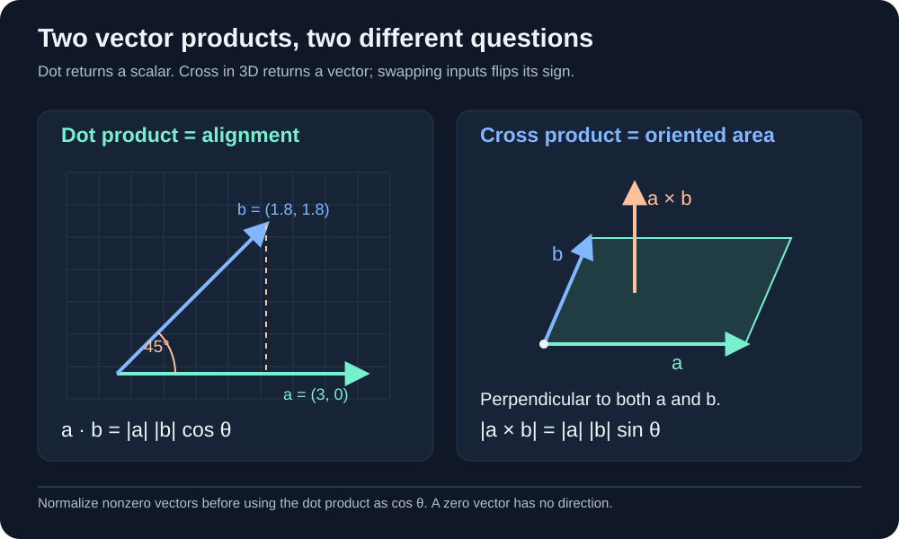

# Vectors: directions, distances, and orientation

A point answers “where?” A vector answers “how far and in which direction?” Both can be stored as three numbers, but their meanings differ. Subtracting two points gives a displacement vector. Adding a displacement to a point gives another point. Adding two positions without interpreting the result usually does not describe a meaningful geometric operation.

**Experiment:** [Vector workbench](#/lab/vectors). **Source:** `labs/math.js` and `labs/02-vectors.js`. **Reading bridge:** Eck §3.5.1; [directional lighting](https://webglfundamentals.org/webgl/lessons/webgl-3d-lighting-directional.html).

## Begin with a displacement you can draw

Suppose a character is at point A `(1,2)` and a destination marker is at point B `(4,6)`. To reach B, the character needs three units of horizontal change and four units of vertical change. We subtract the starting coordinates from the destination coordinates: `(4-1,6-2) = (3,4)`. That pair is a displacement, independent of where we draw its arrow.

Move the same arrow so it starts at `(10,20)`. Its endpoint becomes `(13,24)`. Its components remain `(3,4)` because they describe the change from tail to head, not an absolute location. This ability to relocate a vector without changing it is what makes a direction or velocity reusable across a scene. A position, by contrast, depends on the coordinate origin.

Now connect the displacement to distance. The horizontal and vertical changes form the legs of a right triangle. Pythagoras says the square of the diagonal length equals the sum of the squared leg lengths. Three squared is nine, four squared is sixteen, and nine plus sixteen is twenty-five. The nonnegative square root is five. The diagonal movement is five units even though the sum of component magnitudes is seven.

Adding component magnitudes would measure a different kind of distance: travel constrained to horizontal and vertical segments. That can be useful on a street grid, but it is not ordinary Euclidean straight-line length. Naming the intended measurement matters. A vector's storage does not force a particular distance metric; our rendering and geometric calculations use the Euclidean one unless stated otherwise.

## Components and length

Let $A=(1,2)$ and $B=(4,6)$. The displacement $B-A=(3,4)$ means three units right and four units up. Pythagoras gives its length:

$$
\|v\|=\sqrt{v_x^2+v_y^2+v_z^2}.
$$

For `(3,4,0)`, the length is 5. Component addition combines displacements: `(3,4,0) + (1,-2,0) = (4,2,0)`. Multiplication by a scalar changes length; multiplying by a negative scalar also reverses direction.

A **unit vector** has length 1. To normalize a nonzero vector, divide each component by its length: $\hat v=v/\|v\|$. For `(3,4,0)`, that is `(0.6,0.8,0)`. The hat means unit length. Normalization preserves direction, not magnitude. Never divide a zero vector by its length; our helper returns a zero vector, and camera construction rejects degenerate bases where a direction is required.

## Normalize without losing the meaning of speed

The displacement `(3,4)` points toward the destination but has length five. If we multiply it directly by speed two and time one second, we get `(6,8)`, whose length is ten. We wanted movement of two units, not ten. The displacement's magnitude has accidentally multiplied the intended speed.

Divide each component by five first. The result `(0.6,0.8)` has squared length `0.36 + 0.64 = 1`. Multiplying by speed two and one second gives `(1.2,1.6)`, whose length is two. The direction chooses where to move; speed and time choose how far. Separating these roles makes movement independent of the destination's distance.

A complete console example includes an arrival policy:

```js
function moveToward(position, target, speed, seconds) {
  const difference = target.map((value, axis) => value - position[axis]);
  const distance = Math.hypot(...difference);
  if (distance === 0) return [...target];
  const travel = Math.min(speed * seconds, distance);
  return position.map((value, axis) =>
    value + difference[axis] / distance * travel
  );
}
console.log(moveToward([1, 2], [4, 6], 2, 1));
// [2.2, 3.6]
console.log(moveToward([1, 2], [4, 6], 20, 1));
// [4, 6], without overshooting.
```

The first result advances two of the required five units. The second would request twenty units of travel, so `Math.min` limits it to the remaining five. The zero-distance check avoids a division by zero. A production function should also define whether negative speed or negative elapsed time is allowed; this example assumes both are nonnegative.

Our math helper normalizes lengths above a small threshold and returns a zero vector otherwise. That is a practical policy for optional movement directions, but not every algorithm can use zero as a valid fallback. A camera requires a meaningful forward axis. Its constructor detects degenerate inputs rather than building an orientation from a direction that does not exist.

## The angle fact needed for a dot product

Before the formal trigonometry chapter, we need one small geometric definition. On a radius-one circle, rotate a direction counterclockwise from +X by an angle theta. Its horizontal coordinate is called the cosine of theta. It is one when pointing right, zero when pointing straight up, and minus one when pointing left. In a right triangle, the same value is the adjacent leg divided by the hypotenuse. We use that alignment quantity here; the next chapter develops its units, sine partner, and periodic behavior fully.

## Derive the dot product's alignment meaning

The component formula for a dot product is easy to implement, but why does it measure an angle? Start with two vectors `a` and `b` sharing a tail. Their endpoints and origin form a triangle. The squared distance between the endpoints is the squared length of `a-b`.

Expanding by components gives a useful relationship. In two dimensions, `(ax-bx)^2 + (ay-by)^2` expands into `ax^2 + ay^2 + bx^2 + by^2 - 2*(ax*bx + ay*by)`. The first two grouped pairs are the squared lengths of `a` and `b`. The final grouped sum is their component dot product.

To see the geometric expression, temporarily place A along the horizontal axis. B then has horizontal component equal to its length times the angle cosine. Its perpendicular component is its length times the corresponding unit-circle vertical coordinate, called sine. The two squared unit-circle coordinates add to one by Pythagoras. Subtract A from those two components and expand the squared distance: the two B-squared terms combine to B length squared, while the cross term is minus twice A length times B length times cosine. This is the cosine rule derived from projection and a right triangle.

Geometry therefore gives another expression for that same squared distance through the cosine rule: length-a squared plus length-b squared minus twice their lengths multiplied by the cosine of the included angle. Since both expressions describe the same side of the same triangle, their final terms must agree. Therefore the component dot equals the product of the two lengths and the angle cosine.

This derivation connects a simple sum to a geometric property without asking you to treat the second equality as an unexplained definition. It also explains why normalization matters. A long arrow can produce a large dot even at an unchanged angle. Dividing out the two lengths isolates alignment; unit vectors have already performed that division.

For `a=(2,0)` and a unit direction `b=(0.6,0.8)`, the dot is `2*0.6 + 0*0.8 = 1.2`. Dividing by lengths two and one gives cosine 0.6. If `b` were doubled to `(1.2,1.6)`, the dot would double to 2.4 while the angle stayed the same. A dot value of 2.4 is valid; only a dot between unit directions is constrained to the cosine range.

## The dot product

The dot product multiplies corresponding components and adds:

$$
a\cdot b=a_xb_x+a_yb_y+a_zb_z=\|a\|\|b\|\cos\theta.
$$

The second equality connects arithmetic to geometry. For unit vectors, the dot is the cosine of their angle. Aligned unit vectors produce 1, perpendicular vectors 0, and opposite vectors -1. We explain cosine fully in the next chapter; for now think of it as an alignment factor.

In the vector lab, $a=(2,0)$ and $b$ rotates. At 60°, with length 2, $a\cdot b=2\cdot2\cdot0.5=2$. At 120° it is -2. A negative dot is a geometric signal, not a failed calculation. A light behind a surface has negative alignment with its outward normal; diffuse shading clamps that contribution to zero.

To project `b` onto a **unit** direction $\hat a$, take the scalar length $b\cdot\hat a$ and multiply back by $\hat a$:

$$
\operatorname{proj}_{a}(b)=\frac{b\cdot a}{a\cdot a}a.
$$

The denominator handles a non-unit direction. Do not omit it unless you normalized first. If `a` is zero, the projection direction is undefined.

## Projection separates parallel and perpendicular motion

Suppose an object moves with velocity `(3,4)` while a conveyor belt runs along the horizontal unit direction `(1,0)`. Dotting the velocity with the belt direction gives three. That scalar is the signed amount of velocity along the belt. Multiplying the scalar by the belt direction gives the projected vector `(3,0)`.

Subtracting the projection from the original velocity gives `(0,4)`, the perpendicular remainder. The two pieces add back to the original `(3,4)`. This decomposition is useful for sliding along surfaces, measuring movement toward a target, and resolving a signal into a chosen basis. The projection is not a new position; it is a component of the original vector along another direction.

For a diagonal axis, use the same construction. Let the axis be the unit direction `(0.6,0.8)` and the velocity `(5,0)`. The dot is three, so projection is `(1.8,2.4)`. The remainder is `(3.2,-2.4)`. Their dot with the axis is `3.2*0.6 - 2.4*0.8 = 1.92 - 1.92 = 0`, confirming that the remainder is perpendicular.

A negative scalar projection means the original vector points partly against the chosen positive axis. In the vector workbench, moving B beyond 90 degrees relative to A makes the peach projection point the opposite way. This is useful information. Clamping it to zero would destroy a distinction that movement and visibility calculations sometimes need. Diffuse lighting clamps only because that particular material model excludes backside illumination.

## The cross product

In three dimensions, a cross product returns a vector perpendicular to both inputs:

$$
a\times b=(a_yb_z-a_zb_y,\ a_zb_x-a_xb_z,\ a_xb_y-a_yb_x).
$$

Its length is the parallelogram area spanned by the inputs. Half that length is a triangle’s area. Its direction follows the right-hand rule: curling fingers from `a` toward `b` points the thumb along `a × b`. Reversing the order negates the result. `(1,0,0) × (0,1,0) = (0,0,1)` defines our right-handed convention.



For triangle positions `A`, `B`, `C`, compute `normalize(cross(B-A, C-A))` to obtain one face normal. If the vertices lie on a straight line, the cross is zero: the triangle is degenerate. Adjacent faces can share a position yet need different normals at a sharp crease, a reason vertex data includes more than position.

## The cross product constructs a perpendicular direction

In three dimensions, a pair of nonparallel directions spans a plane. We often need a normal to that plane. A triangle's two edges, a camera's up and backward axes, or a surface's two tangents all provide such pairs. The cross product computes a direction perpendicular to both while retaining an orientation convention.

For `a=(1,0,0)` and `b=(0,1,0)`, substituting into the component formula gives X `0*0 - 0*1 = 0`, Y `0*0 - 1*0 = 0`, and Z `1*1 - 0*0 = 1`. The result is +Z. Reversing the inputs makes each difference change sign, producing -Z. The plane is the same, but its chosen orientation reverses.

For a less axis-aligned example, use `a=(1,0,1)` and `b=(0,2,0)`. Their cross is `(-2,0,2)`. Dotting with A gives `-2 + 2 = 0`; dotting with B gives zero as well. These two checks verify perpendicularity directly using arithmetic we already understand.

The cross length also measures area. Scaling either input by two doubles the parallelogram's area and doubles the cross. Making the inputs parallel collapses the parallelogram to zero area, so the cross becomes zero. This explains why a triangle whose vertices lie on one line has no usable face normal: its two edge directions do not define a unique surface plane.

## Build a triangle normal carefully

Let the triangle vertices be A `(1,0,0)`, B `(3,0,0)`, and C `(1,2,0)`. The edges from A are `(2,0,0)` and `(0,2,0)`. Their cross is `(0,0,4)`. Its length four is the parallelogram area. The triangle occupies half that parallelogram, so its area is two square units. Normalizing gives `(0,0,1)`.

If you cross `C-A` with `B-A` instead, the result is `(0,0,-4)`. A renderer that uses the original triangle winding to identify front faces should use a consistent normal orientation. Otherwise a visible front surface can be shaded as though its normal points inward. A two-sided material can choose a policy for backside normals, but inconsistency is not automatically fixed by disabling face culling.

A mesh corner can need several normals. At a cube corner, three faces meet at right angles. One shared averaged normal points diagonally and produces smooth-looking illumination across those faces. If the intended object is a sharp cube, store separate vertex records for the different face normals even though their position components coincide. The geometric corner and the GPU input record are different concepts.

## A complete numerical experiment

```js
import { subtract, length, normalize, dot, cross } from './labs/math.js';
const displacement = subtract([4, 6, 0], [1, 2, 0]);
console.log(length(displacement));          // 5
console.log(normalize(displacement));       // [0.6, 0.8, 0]
console.log(dot([1, 0, 0], [0, 1, 0]));      // 0
console.log(cross([1, 0, 0], [0, 1, 0]));    // [0, 0, 1]
```

These functions run in a served module and are also tested with Node. Three.js provides the same operations through `Vector3`, but many methods mutate the receiving vector. `direction.subVectors(target, eye).normalize()` computes into `direction`; `target.sub(eye)` changes `target` itself. Use `.clone()` when preserving the original matters.

## Trace the vector lab's numbers into its picture

The lab fixes A to `(2,0)` and constructs B from angle and magnitude. Trigonometry supplies B's components; this chapter supplies the dot and projection operations. The drawing code converts a vector's positive Y into an upward screen movement by subtracting its scaled Y component from the canvas origin's Y. This subtraction is a screen convention, not a change to the mathematical vector.

The peach arrow is drawn on a slightly offset horizontal line to keep it visually separate from A. That offset is presentational. Its length is still the scalar projection of B onto A's normalized direction. Without knowing this, a beginner might mistake the peach arrow's vertical displacement for part of the projection. Reading source together with the explanatory label distinguishes represented data from layout choices.

The `dot` helper loops over components, multiplying corresponding entries and accumulating a sum. It assumes compatible vector lengths. The teaching examples always provide them. A general-purpose public math API might validate dimensions explicitly; a tight internal rendering loop can rely on established data contracts instead. Correctness includes knowing where a contract is checked and where it is assumed.

## Choose a vector representation deliberately

An ordinary array is useful for transparent examples because its component arithmetic is easy to inspect. Three.js `Vector3` provides convenient methods and avoids some repeated indexing. Its mutating method style requires attention: calling `position.add(direction)` changes position. A function returning a new array has a different allocation and ownership behavior.

Neither representation determines the geometry's meaning. A variable called `surfaceNormal` still needs the correct coordinate frame and normalization regardless of class. A variable called `worldPosition` still cannot be dotted with a view-space normal as though they shared a frame. Names and contracts carry information that three numeric components alone cannot express.

As the course progresses, vectors will represent positions after homogeneous conversion, light directions, camera axes, ray directions, and derivatives. The operations remain the ones derived here. The difficult part often becomes choosing the right vectors and frame, so keep the basic arithmetic concrete enough that you can use it as a trustworthy diagnostic.

**Optional application:** compute the velocity direction toward a destination, then move `speed * dt` units along it. Stop at the destination rather than stepping past it. The speed remains constant regardless of distance because the direction is normalized.
