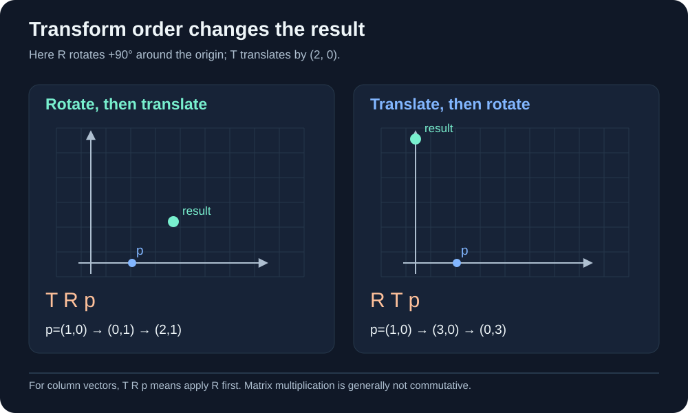

# Matrices as coordinate machines

A matrix packages a transformation so we can apply and combine it consistently. It is a table of coefficients, but its geometric meaning is more useful: its columns describe where basis directions go. Multiplying it by a vector recombines those transformed directions.

**Experiment:** [Transform order](#/lab/transforms). **Reading bridge:** Eck §§2.3 and 3.5.2–3.5.3; [2D matrices](https://webglfundamentals.org/webgl/lessons/webgl-2d-matrices.html).

## From formulas to a matrix

The previous chapter derived a rotation:

$$
\begin{bmatrix}x'\\y'\end{bmatrix}
=\begin{bmatrix}\cos\theta&-\sin\theta\\\sin\theta&\cos\theta\end{bmatrix}
\begin{bmatrix}x\\y\end{bmatrix}.
$$

Each output is the dot product of one matrix row with the input column. For example, the first row gives $x\cos\theta-y\sin\theta$. The first column is the transformed X basis and the second is the transformed Y basis. Scaling uses a diagonal matrix with `sx` and `sy` on the diagonal. The identity matrix has ones on its diagonal and zeros elsewhere; it leaves every input unchanged.

Such a 2 × 2 matrix cannot express translation, because multiplying the zero vector always produces zero. We need one more coordinate.

## Homogeneous coordinates

Represent a 2D point as $(x,y,1)$. A 3 × 3 matrix can then include translation:

$$
T=\begin{bmatrix}1&0&t_x\\0&1&t_y\\0&0&1\end{bmatrix},\quad
S=\begin{bmatrix}s_x&0&0\\0&s_y&0\\0&0&1\end{bmatrix},\quad
R=\begin{bmatrix}c&-s&0\\s&c&0\\0&0&1\end{bmatrix}.
$$

Here $c=\cos\theta$, $s=\sin\theta$. Multiplying `T` by `(x,y,1)` gives `(x+tx,y+ty,1)`. A direction is represented with final coordinate 0, so translation does not affect it. This extra coordinate is not an extra spatial dimension; it is a representation that unifies useful operations.

## Composition and order

Let $M=TRS$. Applying `M` to a column vector scales first, rotates second, translates third. Matrix multiplication composes operations; the rightmost operation acts first. It is associative, so `(T*R)*S` equals `T*(R*S)` within floating-point error. It is generally not commutative: `T*R` usually differs from `R*T`.

Take point `(1,0)`, scale by 2 in X, rotate 90°, then translate by `(3,0)`. The steps give `(2,0)`, then `(0,2)`, then `(3,2)`. If translation happens before rotation, the final location changes. The transform-order lab makes this visible without changing the original polygon.

To rotate around a pivot $q$, move the pivot to the origin, rotate, then move it back: $T(q)RT(-q)$. This formula explains orbiting, hinged doors, and local origins. A common error is rotating an object around the world origin when its geometry was authored far from its own origin.

## Multiplying matrices without mystery

The element in result row `r`, column `c` is the sum of `a[r,k] * b[k,c]` over `k`. Why? The `c`th column of `b` is where one basis goes under `b`; applying `a` to that column gives where it goes after both transforms. Our tested 4 × 4 implementation in `labs/math.js` uses exactly this loop.

Storage order is a separate question. **Column-major** means consecutive values store one column. It does not change the abstract mathematics, and it does not mean “the first operation happens first.” Three.js `Matrix4.set` accepts arguments arranged as rows for readability but stores its `.elements` column-major. WebGL `uniformMatrix4fv` receives column-major values and requires its transpose argument to be `false`.

## Inverses and what they mean

An inverse transform undoes a transform: $M^{-1}M=I$. The inverse of translation by `t` is translation by `-t`; rotation by an angle is undone by rotation by the negative angle; scale is undone by reciprocal scale if no scale factor is zero. The inverse of a product reverses its order: $(TRS)^{-1}=S^{-1}R^{-1}T^{-1}$.

A zero scale destroys information, so there is no unique inverse. A **determinant** is a scalar that, among other things, tells whether a square matrix is invertible: zero means singular. In 2D it is `ad - bc`. Its magnitude is the area scale; its sign tells whether orientation flips. You do not need a general determinant expansion to use these geometric facts.

**Optional application:** calculate the transformed point in the example above by hand, then use the lab’s settings to verify the ordering. In the later 3D math tests, the same idea is checked numerically so storage mistakes cannot silently masquerade as camera bugs.
