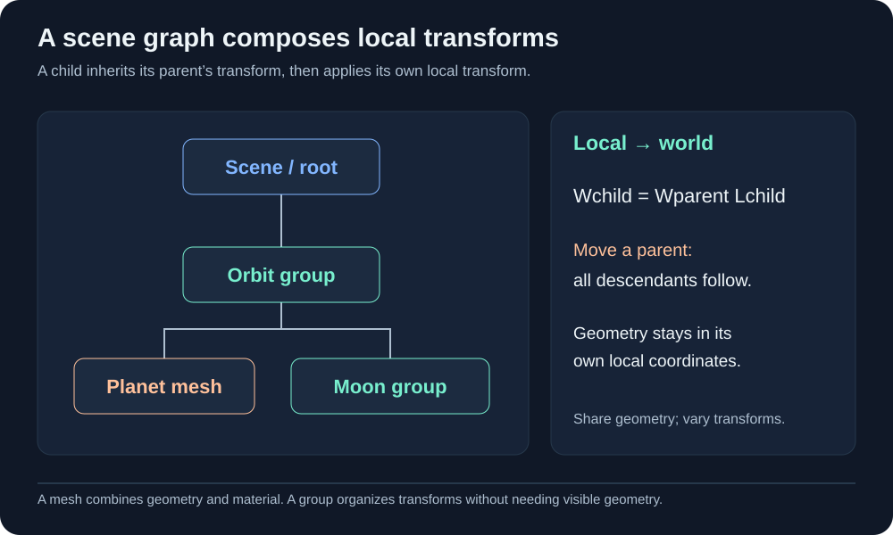

# 3D transforms and coordinate frames

Adding depth does not replace the mathematics you already know. It adds one spatial component, one extra basis direction, and more choices about rotation. The central discipline is always the same: name the coordinate frame in which a quantity is expressed.

**Experiment:** [Scene graph](#/lab/scene-graph), then [raw WebGL cube](#/lab/webgl-cube). **Reading bridge:** Eck §§3.2, 3.3.1, 3.5 and 5.1.3.

## Local, parent, world, and view

An object’s geometry is usually authored in its **local** coordinates. Its transform places it in its parent’s coordinates. Combining transforms up the hierarchy produces a **world** transform. A view transform then expresses world positions relative to the camera. Projection converts view coordinates to a representation suitable for the screen.

If a wheel’s local point is `p`, the wheel is attached to a car, and the car is in the world:

$$
p_{world}=M_{car}M_{wheel}p_{local}.
$$

The wheel does not need to know where the car is. This is hierarchical modeling. A scene graph stores that parent-child relationship and computes composed transforms. In the scene-graph lab, the planet’s local X stays 3 while its world position changes because its orbit parent rotates.



## Four-component representations

A 3D point becomes $(x,y,z,1)$ and a direction becomes $(x,y,z,0)$. Translation occupies the final column of a 4 × 4 affine transform. “Affine” means a linear transform plus translation; it preserves straight lines and parallelism. Perspective is projective rather than affine.

For our column-vector convention:

$$
M=\begin{bmatrix}
m_{00}&m_{01}&m_{02}&t_x\\
m_{10}&m_{11}&m_{12}&t_y\\
m_{20}&m_{21}&m_{22}&t_z\\
0&0&0&1
\end{bmatrix}.
$$

The first three columns describe transformed basis directions. The final column places the origin. Our `translation`, `rotationY`, `scaling`, and `multiply` functions produce and combine these matrices. For example, this runnable module fragment computes a point after scale and translation:

```js
import { multiply, translation, scaling, transform } from './labs/math.js';
const model = multiply(translation(3, 0, 0), scaling(2, 1, 1));
console.log(transform(model, [1, 2, 0, 1])); // [5, 2, 0, 1]
console.log(transform(model, [1, 0, 0, 0])); // [2, 0, 0, 0]
```

The direction receives scale but not translation. A normal is not just any direction; nonuniform scale requires the inverse-transpose transform, derived in the lighting chapter.

## Rotation in 3D

Rotation around Y leaves Y unchanged and rotates the XZ plane. A right-handed rotation in this course is

$$
R_y(\theta)=\begin{bmatrix}c&0&s&0\\0&1&0&0\\-s&0&c&0\\0&0&0&1\end{bmatrix}.
$$

At 90°, +X rotates toward -Z. Rotation order matters even when all operations are rotations. Turning around world Y then local X differs from the reverse. Three Euler angles are convenient, but their order must be specified. Three.js defaults to `XYZ`; a **quaternion**, introduced in animation, provides another rotation representation that avoids Euler interpolation problems.

## Handedness and orientation

“Right-handed” describes a basis relationship, not an unavoidable property of screens. With +X right, +Y up, and +Z toward you, the basis is right-handed. A conventional camera looks along its local -Z. WebGL itself does not require your world convention; your transforms define it. Keep mesh winding, normal directions, culling, and camera conventions consistent.

Scaling one axis by a negative value reflects orientation. A triangle that was counterclockwise can become clockwise. Face culling can then hide what you expected to see. This is especially relevant when importing assets with a different axis system.

## Practical frame bookkeeping

Never dot a world-space normal with a view-space light direction. Never apply an object’s local position as if it were world-space. Never assume a child’s `.position` is global. In Three.js use `getWorldPosition`, `localToWorld`, and `worldToLocal` when crossing these boundaries. If you manually change matrices with automatic updates disabled, explicitly update them before queries.

**Optional application:** add a moon beneath a planet beneath an orbit pivot. Change only the pivot and observe all descendants. Then detach the moon while preserving its world transform; that operation requires converting between its old and new parent frames.
