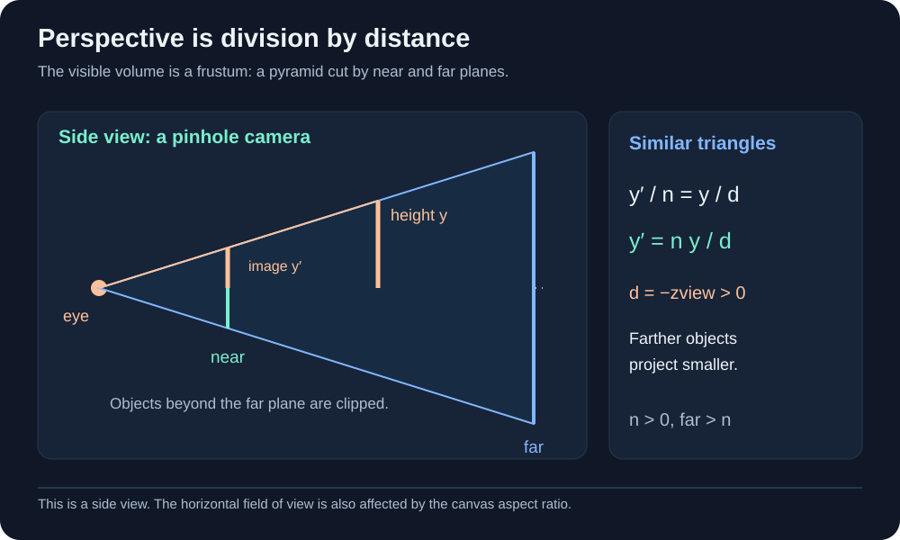

# Cameras, perspective, and clipping

A camera is a coordinate frame plus a projection. Moving a camera does not move the world, but rendering can produce the same image by transforming the world oppositely. This is why the view matrix is the inverse of the camera’s world transform.

**Experiment:** [WebGL cube](#/lab/webgl-cube), using the field-of-view control. **Source:** `perspective` and `lookAt` in `labs/math.js`. **Reading bridge:** Eck §3.3; [perspective](https://webglfundamentals.org/webgl/lessons/webgl-3d-perspective.html) and [cameras](https://webglfundamentals.org/webgl/lessons/webgl-3d-camera.html).

## Constructing a view basis

Let the camera position be `eye`, its focus point `target`, and a preferred up direction `up`. For a camera looking along local -Z:

1. Backward axis: $z=\operatorname{normalize}(eye-target)$.
2. Right axis: $x=\operatorname{normalize}(up\times z)$.
3. Corrected up axis: $y=z\times x$.

These are mutually perpendicular unit directions. A world point `p` becomes view coordinates by subtracting `eye` and projecting onto the basis: $(x\cdot(p-eye),y\cdot(p-eye),z\cdot(p-eye))$. That directly explains the dot products in our view matrix.

If `eye == target`, there is no view direction. If `up` is parallel to `z`, their cross is zero and there is no unique right direction. Choose a different up direction or retain a previous orientation. A numeric guard is better than allowing `NaN` to propagate into every vertex.

## Orthographic versus perspective

An orthographic projection maps coordinates linearly. Equal world lengths remain equal on screen regardless of depth. It is useful for plans, diagrams, and isometric-like views. Perspective makes equal objects appear smaller as distance grows.

Similar triangles explain perspective. A point at horizontal offset `x` and forward distance $d=-z_{view}$ intersects an image plane at a horizontal position proportional to $x/d$. A point twice as far away has half the projected size. There is no need to attach a “make 3D” property to the mesh.

Let the vertical field of view be $\phi$, aspect ratio $a$, near distance $n>0$, and far distance $f>n$. Define $q=1/\tan(\phi/2)$. The standard OpenGL-style perspective matrix is

$$
P=\begin{bmatrix}
q/a&0&0&0\\0&q&0&0\\
0&0&(f+n)/(n-f)&2fn/(n-f)\\
0&0&-1&0
\end{bmatrix}.
$$

Multiplication sets $w_{clip}=-z_{view}$. The GPU later divides X, Y, and Z by W. This **perspective divide** produces the desired distance dependence. The vertex shader should normally output clip coordinates; it should not manually divide and then pretend W was always 1.

## Clip coordinates and NDC are different

In WebGL, a vertex inside the clip volume satisfies $-w\le x,y,z\le w$. After clipping, dividing by W gives NDC from -1 to +1. In WebGPU, X and Y use the same clip inequalities but Z must satisfy $0\le z\le w$, giving NDC depth 0 to 1. The default WebGL depth buffer maps NDC Z from -1..1 into 0..1; the stored depth range alone does not make the projection matrices interchangeable.

Our `perspective(fov, aspect, near, far, true)` creates a WebGPU-style depth projection. To convert an OpenGL clip result to WebGPU explicitly, use $z'=(z+w)/2$ before dividing, leaving X, Y, and W unchanged. Use a matching projection rather than scattering ad hoc conversions across shaders.

## Near plane and depth precision

The near plane must be positive for this perspective camera. A near plane of zero makes the projection invalid. Perspective depth precision is concentrated near the camera, so a huge far/near ratio makes distant overlapping surfaces difficult to distinguish. **Z-fighting** is the flickering pattern when surfaces quantize to nearly identical depths. Move the near plane outward when possible, reduce the far plane, separate surfaces, or use an appropriate depth strategy.

Field of view is not identical to camera distance. Moving closer changes perspective relationships; narrowing field of view from farther away compresses them. To preserve framing when resizing, update aspect ratio and rebuild the projection matrix. In Three.js call `camera.updateProjectionMatrix()` after changing its fields.

**Optional application:** inspect `tests/math.test.mjs`. It verifies that a point at view Z = `-near` maps to the near depth and `-far` maps to the far depth for both APIs. These endpoint checks catch sign and layout mistakes more reliably than eyeballing a cube.
