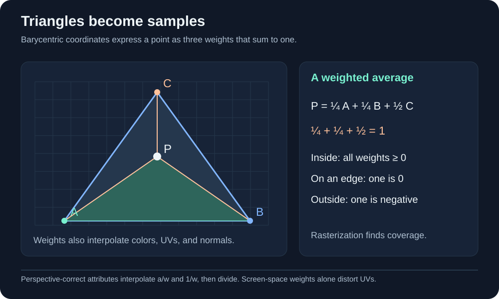

# From triangles to fragments

A GPU does not need a complete geometric description of every curved object. A mesh approximates its surface with triangles. A triangle is planar, easy to interpolate across, and remains a triangle under affine transformations. More triangles improve approximation until another bottleneck matters.

**Experiment:** [Software triangle rasterizer](#/lab/rasterizer). **Reading bridge:** Eck §§3.4 and 6.1.3; [how WebGL works](https://webglfundamentals.org/webgl/lessons/webgl-how-it-works.html).

## Why a triangle is a convenient surface piece

Three noncollinear points determine a plane. Connecting those points gives a triangle with an unambiguous flat interior. A four-corner polygon may be bent in 3D or may require a choice of diagonal, but each triangle is planar by construction. Splitting complex surfaces into triangles therefore gives the renderer a regular primitive to process.

A curved sphere mesh is a collection of flat triangles approximating a curved shape. Smooth normals can make its illumination look smooth, but its silhouette still follows the actual triangle edges. Adding more subdivisions improves that geometric approximation. It does not by itself improve the final image's sampling or make a low-resolution texture more detailed.

This separation matters when choosing a fix. A faceted silhouette needs geometry or a different representation. A smooth silhouette with jagged pixel steps needs sampling/antialiasing. A smooth outline with blocky surface color may need texture filtering or resolution. These symptoms refer to different stages of the image-generation process.

## Vertices describe corners and more

A **vertex** is an input record. It may contain position, normal, color, texture coordinate, skinning weights, and other attributes. A triangle consumes three vertex records. If two faces meet at a sharp edge, the same spatial corner can require different normals or UVs, so it needs separate vertex records even though the positions match.

Rasterization determines which samples a projected primitive covers. A **fragment** is a candidate contribution for a sample; it is not automatically the final pixel. It can fail depth or stencil tests, be discarded, or be blended with an existing value. Multisampling and early tests make the exact scheduling more involved than “one fragment shader call per pixel.”

## From vertex records to a projected triangle

Suppose the CPU provides three positions and three colors. The vertex shader transforms each position into clip coordinates and forwards each color. Primitive assembly knows the draw topology, so it groups each three outputs into a triangle. Clipping can cut away parts outside the camera volume and create appropriate new boundary vertices before screen-space coverage is considered.

After the perspective divide and viewport mapping, the triangle has screen-space corners. Rasterization now asks which sample locations are inside its projected boundary. This is a geometric coverage question. The fragment shader's material calculation is a later responsibility; changing a fragment color does not normally move the triangle's edges.

A vertex record can be reused through an index buffer, and implementations can cache transformed results. It is therefore more precise to discuss conceptual per-vertex processing than to promise exactly one physical shader invocation for every repeated index. The model you need is that each referenced record supplies the inputs from which the primitive is constructed.

## Derive barycentric weights on a simple triangle

Choose A `(0,0)`, B `(4,0)`, and C `(0,4)`. A point P `(1,1)` lies one quarter of the horizontal extent from A toward B and one quarter of the vertical extent from A toward C. We can write P as `0.5*A + 0.25*B + 0.25*C`. The weights sum to one, so the origin placement is preserved.

For this axis-aligned triangle, the B weight is `x/4` and C weight `y/4`. The remaining A weight is `1 - x/4 - y/4`. At P `(1,1)`, that becomes one minus one quarter minus one quarter, giving one half. At P `(3,3)`, it becomes negative one half, showing that P lies outside the triangle across the edge opposite A.

The sum-to-one requirement is what makes these coordinates describe an affine combination rather than an arbitrary scaled sum. A translation of all three vertices translates the interpolated point by the same amount. Without normalized weights, moving the triangle could also change its size or offset incorrectly.

An edge corresponds to one weight becoming zero. Along edge BC, A contributes nothing. At vertex B, B weight is one and the other two zero. These endpoint properties are useful tests for any barycentric implementation. A function that gives the wrong vertex weights will interpolate every attribute incorrectly even if some interior colors look plausible.

## Derive the area interpretation

The full right triangle above has area eight: half of base four times height four. Connect P `(1,1)` to all three corners. The subtriangle opposite B has base along AC of length four and horizontal height one, giving area two. Its fraction of full area is one quarter, matching B's weight.

The subtriangle opposite C likewise has area two. The remaining subtriangle opposite A has area four, giving weight one half. For an arbitrary triangle, signed-area ratios generalize this construction. Signed areas retain orientation information, allowing weights outside the triangle to become negative instead of losing which side of an edge the point occupies.

A zero-area triangle has no stable denominator. If A, B, and C lie on a line, the supposed two-dimensional region has collapsed. Our `barycentric` helper returns `null` in that case. This is a meaningful geometric result. Dividing by a tiny area without a guard can produce enormous weights that then contaminate colors, UVs, or geometric queries.

## Barycentric coordinates

Any point in a triangle’s plane can be written using weights:

$$
p=\lambda_A A+\lambda_B B+\lambda_C C,\qquad
\lambda_A+\lambda_B+\lambda_C=1.
$$

The lambdas are **barycentric coordinates**. Inside the triangle all three are nonnegative. On an edge, the opposite weight is zero. At vertex A, the weights are `(1,0,0)`. The weights are also ratios of signed subtriangle areas to the full triangle’s signed area.

For A `(0,0)`, B `(1,0)`, C `(0,1)`, point `(0.2,0.3)` has weights `(0.5,0.2,0.3)`. Interpolating red, green, and blue vertex colors with those weights yields `(0.5,0.2,0.3)`. The software lab evaluates this explicitly at sample centers and paints the covered cells.



The denominator in the weight formula is proportional to triangle area. If it is zero, the triangle is degenerate and no stable interior exists. Our helper returns `null`. Real rasterizers also use consistent edge rules, such as a top-left convention, so two adjacent triangles do not double-cover or leave a gap along a shared edge. The educational lab includes boundaries simply; it is not a bit-for-bit hardware rasterizer.

## Use an edge function to test coverage

For an oriented edge from A to B, the expression `(Bx-Ax)*(Py-Ay) - (By-Ay)*(Px-Ax)` measures signed parallelogram area. Its sign says which side of the directed edge contains P. Evaluating all three edges gives a compact inside test when orientation is handled consistently.

Take edge A `(0,0)` to B `(4,0)`. The expression becomes `4*Py`, positive for points above the edge. For edge B `(4,0)` to C `(0,4)`, point `(1,1)` gives `(-4)*1 - 4*(-3) = 8`, again positive. The final edge also gives positive for this interior point. Reversing triangle orientation reverses the expected signs.

This complete console example exposes the three tests:

```js
function edge(a, b, point) {
  return (b[0] - a[0]) * (point[1] - a[1])
       - (b[1] - a[1]) * (point[0] - a[0]);
}
const a = [0, 0], b = [4, 0], c = [0, 4];
for (const point of [[1,1], [3,3], [2,0]]) {
  const signs = [edge(a,b,point), edge(b,c,point), edge(c,a,point)];
  console.log(point, signs, signs.every(value => value >= 0));
}
```

The boundary point `(2,0)` produces zero for one edge. The educational test includes it. Hardware uses a consistent boundary ownership policy so adjacent triangles sharing an edge do not both claim or both omit the same sample under the intended rasterization rules. This detail matters for a watertight mesh, but it does not change the core signed-area reasoning.

## Interpolate a color numerically

Assign red `(1,0,0)` to A, green `(0,1,0)` to B, and blue `(0,0,1)` to C. At weights `(0.5,0.25,0.25)`, multiply each vertex color by its weight and sum. The result is `(0.5,0.25,0.25)`. A contributes only red, B only green, and C only blue, making the weights directly visible as channels.

For arbitrary vertex colors, use the same operation component by component. If A is `(0.2,0.4,0.6)` and all three vertices have that same value, normalized weights reproduce it exactly in ideal arithmetic. This constant-preservation check is another useful diagnostic. A gradient that changes despite identical vertex inputs indicates a problem outside the intended interpolation formula.

The software rasterizer lab intentionally uses the primary-color arrangement because it reveals its mathematics. It evaluates coarse sample centers and displays the selected point's weights. The displayed X/Y sliders live in normalized mathematical coordinates, while drawing flips Y to fit Canvas's top-left convention. The color values are illustrative interpolation data rather than a full physically based color pipeline.

## Understand the perspective correction with two unequal depths

Consider an attribute varying between endpoints whose clip W values differ. Projection changes distances nonlinearly, so a screen-space midpoint does not generally correspond to a geometric midpoint along the original surface. Directly averaging the attribute at that screen midpoint would attach the wrong value to the visible location.

Use two weights of one half for a simple calculation. Let attribute values be zero and one, with W values one and two. The numerator of perspective correction is `0.5*0/1 + 0.5*1/2 = 0.25`. The denominator is `0.5/1 + 0.5/2 = 0.75`. The corrected value is one third, not one half.

The nearer endpoint influences more screen extent, so the screen midpoint corresponds to a different position on the original segment. Dividing attribute values by W before interpolation, then dividing by the interpolated reciprocal W, reconstructs the projectively consistent result. The triangle formula applies the same reasoning to three vertices.

GLSL's default smooth floating-point interpolation performs this correction for varyings. You normally supply the attribute at vertices and let the rasterizer handle it. Manually dividing an attribute by W and then also using default perspective correction can apply an unwanted second correction. Know which representation crosses the stage boundary.

## Perspective-correct interpolation

Interpolating a UV directly in screen space distorts textures when vertex distances differ. Projection divides positions by W, so interpolation must account for the same projective relationship. For screen-space barycentric weights $\lambda_i$, an attribute `a` is reconstructed as

$$
a(p)=\frac{\sum_i\lambda_i a_i/w_i}{\sum_i\lambda_i/w_i}.
$$

When all W values are equal, the factors cancel and ordinary linear interpolation works. When they differ, the correction prevents a receding checkerboard from bending across the diagonal between triangles. GLSL `smooth` interpolation, the default for floating-point varyings, handles this for you. `flat` uses one vertex’s value without interpolation and is useful for discrete labels or face IDs. WGSL has interpolation attributes for the corresponding choices.

## A fragment is not yet a stored pixel

Suppose two triangles overlap at one sample. Each can generate a candidate fragment with a color and depth. With a conventional depth buffer cleared to one and a less-than comparison, a fragment at depth 0.7 can pass and store its value. A later fragment at 0.3 passes because it is nearer, replacing the depth. Reversing their order leaves 0.3 as the visible opaque result as well.

A later fragment at 0.8 fails against stored depth 0.3 and does not replace the visible surface. This is the visibility role of depth testing. The fragment shader and hardware can have optimizations that change when work occurs, so do not infer exact invocation counts from this conceptual sequence. The correctness requirement is the final test-and-store behavior.

Blending changes the color combination policy. A translucent foreground depends on the color behind it, so depth alone cannot make arbitrary draw orders equivalent. Common pipelines draw opaque surfaces first and transparent surfaces later with depth testing but no depth writing. Intersecting translucent geometry still needs more advanced treatment or an explicit approximation.

## Depth and visibility

A depth buffer stores a depth value per sample. With a conventional `LESS` comparison and a clear depth of 1, a nearer fragment passes and updates the stored value. Drawing opaque meshes in a different order should then preserve visibility, assuming matching depth state. Without the depth test, the last drawn triangle can cover a nearer triangle.

Transparent objects complicate this because the color depends on what lies behind them. They commonly depth-test against opaque geometry but avoid writing depth, and are drawn back to front. Object-level sorting cannot solve every case of intersecting translucent triangles. We return to alternatives in production rendering.

## Culling and aliasing

Face culling skips triangles whose projected winding identifies them as back-facing. It saves work and matches closed solid surfaces, but hides thin surfaces if their intended visible side is opposite. Antialiasing addresses the sampling of sharp edges. More geometry does not by itself fix stair-step silhouettes when the final image is undersampled.

## Coverage sampling and material sampling differ

MSAA uses multiple coverage/depth sample positions per pixel and can improve geometric boundaries. It does not guarantee that every high-frequency procedural material or texture is adequately filtered. A triangle covering an entire pixel can still contain a checker pattern changing many times inside that pixel.

Texture mipmaps address another sampling problem by prefiltering image detail as its screen footprint shrinks. Analytic shader antialiasing can soften a procedural boundary based on screen derivatives. Temporal methods gather information across frames under additional motion assumptions. These techniques address overlapping but distinct sources of instability.

In the coarse software lab, each displayed square is one deliberately magnified sample cell. Raising resolution reduces cell size, but it does not turn the implementation into a full GPU coverage model. Its purpose is to expose inside tests and interpolation numerically. Keep that teaching scope in mind when comparing its boundary behavior with hardware rendering.

## Connect the rasterizer to later techniques

Picking a triangle on the CPU can use barycentric coordinates to reconstruct UVs or other attributes at a hit. A ray tracer also benefits from triangle interpolation even though visibility is found by rays rather than screen coverage. Skinning and morphing change vertex positions before rasterization, while materials change per-fragment appearance afterward.

This gives you a useful map for debugging: geometry and transforms determine where the primitive appears; coverage determines which samples participate; interpolation determines the values available inside it; shading determines the candidate output; visibility and blending determine what remains. An error should be investigated at the stage whose input contract matches the symptom.

**Optional application:** move the rasterizer’s sample outside the triangle and observe a negative weight. This gives a geometric interpretation to a value that might otherwise seem like an error. Then inspect how the raw cube uses a depth buffer to resolve triangles covering the same sample.
