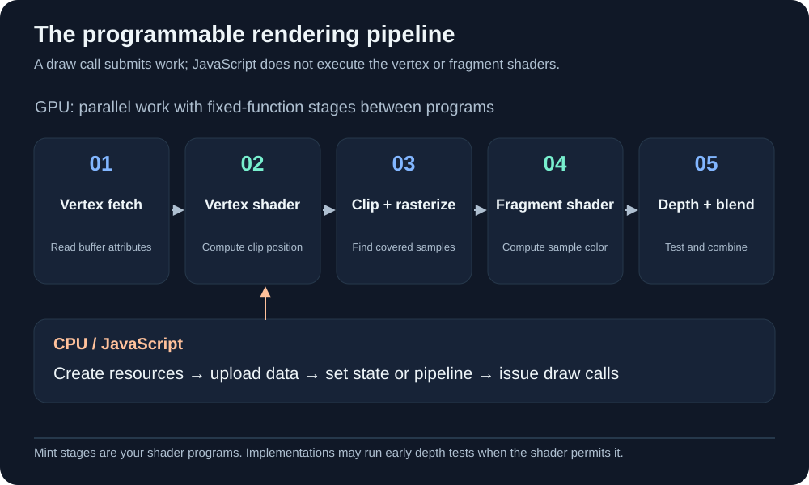

# The GPU and the programmable pipeline

The CPU runs your JavaScript, organizes the application, and requests work. A GPU is designed to process many similar pieces of work efficiently. Rendering a million sample colors has a great deal of this repeated structure. The GPU is not simply “a faster CPU,” and uploading data or reading results back has costs.

**Experiment:** [First GPU triangle](#/lab/webgl-triangle). **Reading bridge:** Eck §6.1; [WebGL Fundamentals](https://webglfundamentals.org/webgl/lessons/webgl-fundamentals.html) and [state diagram](https://webglfundamentals.org/webgl/lessons/resources/webgl-state-diagram.html).

## A pipeline is a sequence of responsibilities

For a conventional triangle draw:

1. JavaScript prepares buffers and render state.
2. A vertex shader computes a clip-space position and other outputs for each vertex invocation.
3. Primitive assembly groups vertices into triangles; clipping handles boundaries.
4. Rasterization determines covered samples and interpolation values.
5. A fragment shader computes candidate colors and possibly other outputs.
6. Depth, stencil, blending, and related operations determine what is stored.

Hardware can optimize, overlap, or run some tests early. This is a conceptual flow, not a promise of a strict one-fragment-one-pixel execution schedule.

The **vertex shader** does not position an entire object in one invocation. It runs over vertex inputs, and each invocation produces one output record. The **fragment shader** does not run JavaScript or query the DOM. It runs GLSL code with the data the pipeline makes available.

## Four routes into shader data

An **attribute** provides per-vertex inputs, read from buffers according to a layout. A **uniform** supplies values constant across a draw, such as a camera matrix. A **texture** provides sampled data accessible by coordinates. A **varying** connects a vertex output to interpolated fragment input. In WebGL 2 GLSL, both stage interfaces use `in` and `out`; older examples use `attribute`, `varying`, and `gl_FragColor`.

Imagine a JavaScript array of position and color records. You upload it once to a buffer. You tell WebGL which bytes form a position and which form a color. Your vertex shader computes a position and forwards color. The rasterizer interpolates color. The fragment shader writes it. Changing a uniform can animate every vertex without rewriting the vertex buffer.

## WebGL is a state machine

Calling `bindBuffer` chooses a current buffer for a target; it does not draw. `vertexAttribPointer` describes how an attribute reads data and captures the currently bound array buffer into vertex-array state. `useProgram` selects shaders. `drawArrays` or `drawElements` asks the GPU to use the selected state to draw.

Think of state setup as assembling the inputs to a function call. Unfortunately, many inputs live in mutable global context state rather than being explicit arguments to the draw. Encapsulate setup to avoid hidden dependencies. A program can compile correctly yet render nothing because its attribute array is disabled, its viewport is zero, its winding is culled, or its transform moves the mesh outside the clip volume.

## Commands are usually asynchronous

JavaScript submits work; the browser and driver arrange GPU execution. A short CPU time around `drawArrays` measures submission overhead, not necessarily completed rendering. Operations such as reading pixels or synchronously requesting results can force expensive waiting. Keep intermediate results on the GPU when possible.

Shader invocations also do not have a convenient global order. A fragment should not assume its neighbor ran first. Shaders are small data-parallel programs, not loops whose previous iteration’s ordinary local variables survive into the next invocation. Compute shaders later add explicit shared-memory and synchronization mechanisms, still with constraints.

## WebGL 1 versus WebGL 2

The requested WebGL Fundamentals site primarily teaches WebGL 1. Its mental model remains valuable. This course uses WebGL 2: request `'webgl2'`, use GLSL ES 3.00 with `#version 300 es`, use `in`/`out` interfaces, declare a fragment output, and use core vertex array and instancing APIs. WebGL 1 extension examples may need translation. Do not mix shader versions between stages or paste WebGL 1 syntax into a WebGL 2 shader unchanged.

## A reliable debugging sequence

First verify that a context exists and that clearing changes the canvas. Next draw a fixed triangle with a fixed color. Then add a position buffer, then color, then transforms. If the image disappears, the most recent change narrows the search. Shader compile and program link logs are evidence, not optional decoration. Our `program` helper checks both and throws useful errors.

**Optional application:** inspect the complete triangle lab and identify which statements prepare state and which one actually requests drawing. There is one draw call per frame. Its result is the combination of all the state prepared before it.
