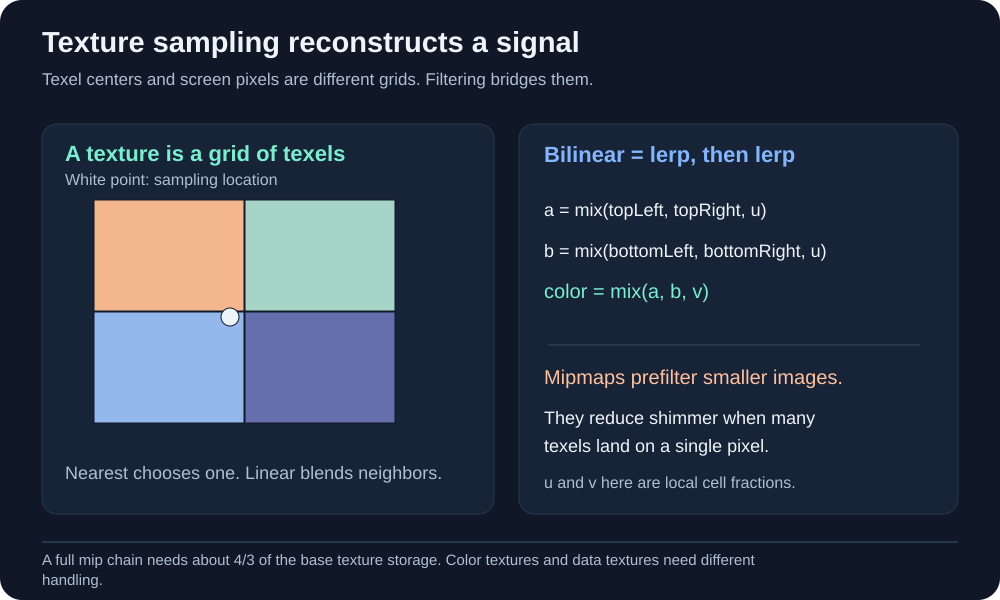

# Textures and sampling

A texture is a GPU data resource with a coordinate-based lookup interface. It may contain a photograph, a normal map, a shadow map, a table of simulation values, or a generated pattern. The lookup rules are as important as the stored values.

**Experiment:** [The sampling room](#/lab/textures). **Reading bridge:** Eck §§4.3, 6.4, 7.3; [textures](https://webglfundamentals.org/webgl/lessons/webgl-3d-textures.html), [texture units](https://webglfundamentals.org/webgl/lessons/webgl-texture-units.html), and [perspective-correct mapping](https://webglfundamentals.org/webgl/lessons/webgl-3d-perspective-correct-texturemapping.html).

## UV coordinates

A mesh commonly stores two texture coordinates per vertex, called U and V so they are not confused with spatial X, Y, and Z. A square image usually uses normalized UVs from 0 to 1. These coordinates interpolate across triangles. A seam occurs where one spatial position must map to two texture locations; the mesh then needs duplicate vertex records.

Sampling at `(0.5,0.5)` means the middle of the texture, not necessarily one exact texel. A **texel** is a stored texture element. A pixel is a screen element. Their sizes can differ dramatically as a surface turns or moves away.

## A texture object, a unit, and a sampler uniform

In WebGL, a texture object owns image storage and parameters. A texture unit is a numbered binding slot. A sampler uniform selects a unit index, not a texture object pointer and not the enum `gl.TEXTURE0` itself.

```js
gl.activeTexture(gl.TEXTURE0);
gl.bindTexture(gl.TEXTURE_2D, texture);
gl.useProgram(program);
gl.uniform1i(gl.getUniformLocation(program, 'image'), 0);
```

The last `0` means unit zero. The fragment shader calls `texture(image, uv)`. Multiple samplers can refer to different units, allowing base color, normal, and roughness data to be combined. WebGL 2 also offers sampler objects that separate sampling state from texture storage.

## Filtering is reconstruction

Nearest sampling selects a nearby texel and gives crisp blocks under magnification. Bilinear filtering blends four nearby texels from one mip level. It smooths magnification but cannot adequately suppress all aliasing when many texels collapse into one screen pixel.

A **mipmap** chain contains progressively smaller filtered versions. For a square image of side `N`, the next level has side `N/2`, then `N/4`, down to 1. A complete chain occupies approximately $1+1/4+1/16+\dots=4/3$ of the base-level storage. The sum follows because each level has a quarter as many texels as the previous one.

Trilinear filtering combines bilinear samples from two neighboring mip levels. Anisotropic filtering handles elongated footprints, such as a floor viewed at a grazing angle, using additional samples when supported. Mipmaps reduce high-frequency detail before sampling; they are not merely a blur effect applied afterward.



In the lab, increase repeats until each texel becomes smaller than a pixel. Nearest and ordinary bilinear sampling can produce unstable patterns. Trilinear mipmaps produce a steadier average. The texture is a 32 × 32 generated RGBA array, so the result requires no image download.

## Wrapping, completeness, and image loading

Clamp-to-edge extends the edge texel. Repeat wraps coordinates modulo one. Mirrored repeat alternates direction. Atlas padding matters: bilinear and mip filtering can pull colors from neighboring tiles. Add gutters and construct mips appropriately rather than relying only on exact UV endpoints.

WebGL 1 restricts non-power-of-two textures: repeated wrapping and mipmapped minification have limitations. WebGL 2 removes those particular NPOT restrictions, but the texture still needs valid storage for its chosen minification filter. Selecting a mip filter without a valid mip chain is a common cause of incomplete texture sampling.

Image downloads are asynchronous. Upload a placeholder, wait for decoding, upload the image, and generate mipmaps if the format permits. Cross-origin images need server cooperation through CORS; `crossOrigin = 'anonymous'` alone cannot grant access. Handle failed downloads explicitly. Decide on vertical orientation once: image source origin, upload flipping, mesh UVs, and render-target conventions interact.

## Color data versus numerical data

An sRGB base-color texture should decode to linear light before shading. A normal texture stores direction components and must not receive sRGB decoding. A roughness texture stores parameters, not photographed brightness. Raw WebGL can use an sRGB internal format such as `SRGB8_ALPHA8` for color textures; choose supported formats and matching upload types.

**Optional application:** add a second generated texture and mix it with the checker using a uniform parameter. The data, two unit bindings, two sampler uniforms, and the fragment expression are four separate responsibilities. Start with a tiny known pattern to verify orientation before loading a complex asset.
