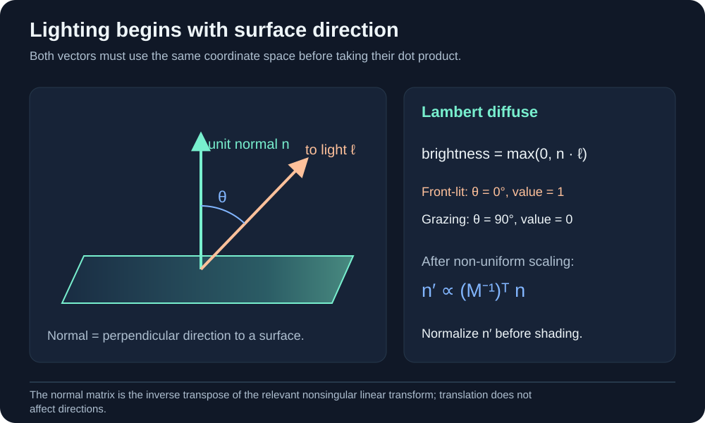

# Lighting and the geometry of normals

An unlit color says what to display regardless of surroundings. A lit material estimates how much light reaches the camera after interacting with a surface. We begin with a deliberately small model so every term has a geometric meaning.

**Experiment:** [Lit WebGL cube](#/lab/webgl-cube). **Reading bridge:** Eck §§4.1, 7.1.4, 7.2; [point lighting](https://webglfundamentals.org/webgl/lessons/webgl-3d-lighting-point.html) and [spot lighting](https://webglfundamentals.org/webgl/lessons/webgl-3d-lighting-spot.html).

## First distinguish shape, material, illumination, and visibility

A useful lighting experiment starts with a white patch. Its geometry determines where it is and which way it faces. Its material determines how incoming light is redistributed. A light determines what illumination arrives. Visibility determines whether another surface blocks that illumination. The camera determines which outgoing direction reaches the image. These roles interact, but replacing one cannot generally repair an error in another.

Suppose a face is dark. It could face away from the light, have a dark reflectance, lie in a shadow, or receive no relevant environment light. Increasing exposure changes the display treatment of the whole scene. Flipping the face normal changes its angular relationship. Removing a shadow test changes visibility. Each can make the patch brighter for a different reason. The goal of a controlled experiment is to identify the reason before adjusting an unrelated parameter.

Our cube intentionally starts with a small lighting model. It has one fixed directional illumination term and a constant fill term. It has no shadow-map pass and no local reflections. Turning the cube changes which faces align with the light, while the model rotates their normals into the same world frame. This restricted setup is valuable precisely because you can account for every brightness change without a complete material engine.

## Construct a face normal from positions

Take triangle A at `(0,0,0)`, B at `(2,0,0)`, and C at `(0,3,0)`. The edge vectors are B minus A, `(2,0,0)`, and C minus A, `(0,3,0)`. Their cross product is `(0,0,6)`. Its length is six, the parallelogram area spanned by those edges. Normalizing divides by six and produces `(0,0,1)`, an outward orientation for this winding.

If you exchange B and C, the cross becomes `(0,0,-6)`. The physical plane is unchanged, but its selected front orientation reverses. This connection explains why winding and normals should agree. Back-face culling can remove one winding while your lighting code still uses whatever normals you uploaded. The rasterizer does not automatically infer that inconsistent normal data should be corrected.

A triangle with collinear points has a zero cross product. There is no unique normal to its zero-area surface. Guard against normalizing that zero vector when generating geometry. Degenerate data can arise from collapsed scale, duplicate points, or a parameterization at a singular location. Treat it as a geometry condition with an explicit policy rather than expecting a lighting formula to manufacture a meaningful direction.

For a smooth sphere centered at the origin, the radial direction is also the geometric normal. At point `(0.6,0.8,0)` on a unit sphere, the normal is already unit length. A polygonal sphere approximates that shape, so smoothly varying radial normals can suggest a smooth surface even though the silhouette remains a set of triangles. Shading smoothness and geometric resolution are distinct properties.

## Normals describe surface orientation

A normal is a direction perpendicular to a surface. For a triangle, cross two nonparallel edge vectors and normalize. For a smooth mesh, vertex normals can be averaged across neighboring faces, then interpolated and normalized per fragment. A box should keep separate face normals; a sphere usually benefits from smoothly changing normals.

Interpolation does not preserve unit length. Always normalize an interpolated normal before using it in an angular expression. And keep all vectors in one frame: world normal with world light direction, or view normal with view light direction.

## Why interpolated normals need a second normalization

Suppose two unit normals are `(1,0,0)` and `(0,1,0)`. Their halfway linear interpolation is `(0.5,0.5,0)`. Its length is `sqrt(0.25+0.25)`, about 0.707, not one. A third normal and perspective interpolation change the details but not the general fact: weighted averages of unit directions do not generally stay on the unit sphere.

If you dot that shortened normal with a light, the result includes its accidental length. Brightness then changes not only because orientation changes but also because interpolation shrank the vector. Normalizing in the fragment shader removes that unintended magnitude factor. This is one reason simply normalizing vertex normals before upload is insufficient for smooth per-fragment lighting.

Normals across a hard edge should not be averaged if the intended surface is faceted. The cube stores four records per face so each face keeps its own constant normal. A smooth sphere can share appropriately compatible records and interpolate normals. Neither strategy is universally more correct; it depends on the modeled surface and desired shading discontinuities.

## Work through the diffuse dot product numerically

Let the face normal be `(0,0,1)`. A unit light direction `(0,0,1)` points directly outward from the face toward the source. Their dot product is one. A unit light direction `(1,0,0)` is tangent to the face, so the dot is zero. The direction `(0,0,-1)` lies behind the face and gives negative one. Clamping the result to zero prevents a one-sided surface from receiving a negative diffuse contribution.

For a less special case, take light direction `(0,3,4)`. Its length is five, so its unit version is `(0,0.6,0.8)`. Dotting with `(0,0,1)` gives 0.8. If the surface's linear base color is `(0.2,0.5,0.8)` and the light is white with unit scale, the simple diffuse result is `(0.16,0.4,0.64)`. Each channel is the corresponding reflectance multiplied by the same geometric factor.

If the light color is warm, say `(1,0.8,0.5)`, multiply channel by channel as well. The result becomes `(0.16,0.32,0.32)`. This is component multiplication for color modulation, combined with a scalar dot product for alignment. Keeping these two operations distinct makes the shader easier to read. The dot computes how much the directions align; the channel products compute how the material and light spectra are approximated by RGB.

This complete console example verifies the arithmetic without requiring a canvas:

```js
const normal = [0, 0, 1];
const light = [0, 3 / 5, 4 / 5];
const base = [0.2, 0.5, 0.8];
const lightColor = [1, 0.8, 0.5];
const alignment = Math.max(0,
  normal.reduce((sum, value, i) => sum + value * light[i], 0)
);
const result = base.map((value, i) => value * lightColor[i] * alignment);
console.log(alignment, result); // 0.8, approximately [0.16, 0.32, 0.32]
```

The example assumes the input colors are already linear quantities. If you start from sRGB image values, decode them first. Otherwise the formula performs correct arithmetic on the wrong representation of brightness. This is why the earlier color chapter belongs before lighting rather than being an optional polish topic at the end.

## Lambert’s cosine factor

Imagine a beam illuminating a flat patch. Tilting the patch spreads the same arriving light over more surface area. The contribution decreases with the cosine of the angle between its normal `n` and the direction `l` **toward the light**:

$$
L_{diffuse}=k_d C_{light}\max(0,\hat n\cdot\hat l).
$$

`kd` is a diffuse reflectance factor and `C_light` is incoming light color/intensity in linear units. The dot assumes unit vectors. `max(0,...)` removes light arriving from behind a one-sided surface. A physically normalized Lambertian BRDF includes a $1/\pi$ factor; this simple teaching equation absorbs constants into the light scale. Later PBR systems use a more complete convention.

A directional light has a common direction everywhere. A point light’s direction is `lightPosition - surfacePosition`, and its intensity physically decreases approximately as $1/r^2$ in unobstructed space. Clamp or soften the near-source singularity in an artistic renderer. A spotlight adds a cone falloff based on another dot product. These are distinct geometric factors.



## Derive the fixed cube shader's brightness

The actual cube shader uses a light direction `normalize(vec3(1,2,3))`. Its length is `sqrt(1+4+9)`, or approximately 3.742. The unit direction is approximately `(0.267,0.535,0.802)`. At model rotation zero, the +X face has alignment about 0.267, the +Y face 0.535, and the +Z face 0.802. These faces receive different diffuse values even though their base color is identical.

The shader combines the diffuse value with `0.12 + 0.88 * diffuse`. The constants produce a twelve-percent floor and scale the directional part to the remaining eighty-eight percent. For the +Z face the multiplier is approximately `0.12 + 0.88*0.802 = 0.826`. For the opposite -Z face, clamping removes the negative dot and leaves 0.12. This floor makes the teaching cube readable, but it is not a calculation of bounced illumination.

After multiplication the lab applies a power of `1/2.2` as an approximate display encoding. The code labels a small illustrative linear-light calculation rather than a complete color-managed PBR pipeline. The Three.js studio later uses its managed output color and tone-mapping path. Comparing them is useful, but do not assume all their numeric color constants refer to identical authored conditions.

## Prove the normal transform with one scaled line

A full matrix proof can feel abstract, so first inspect a two-dimensional cross-section. Let a surface tangent be `(1,-1,0)` and a normal `(1,1,0)`. Their dot is `1 - 1 = 0`, so they are perpendicular. Scale X by two. The tangent becomes `(2,-1,0)`. If you transform the normal in the same way, it becomes `(2,1,0)`, whose dot with the new tangent is `4 - 1 = 3`. Perpendicularity has been lost.

Instead transform the normal by reciprocal X scale. It becomes `(0.5,1,0)`. Its dot with `(2,-1,0)` is `1 - 1 = 0`. That is the geometric result the inverse transpose generalizes. The transform must preserve the normal's perpendicular relationship to every transformed tangent, rather than preserve its appearance as an ordinary displacement arrow.

For a general invertible linear matrix A, let the old normal be n and old tangent t. Choosing the new normal as inverse-transpose A applied to n makes the new dot equal to the old dot. Matrix transpose is involved because a dot product can be written as a row-vector times a column-vector. The inverse cancels the tangent's A, leaving the original perpendicularity. Finally normalize because the resulting vector's length is not itself a lighting parameter.

Translation does not enter this normal matrix because it does not change surface tangent directions. A zero scale is more serious: it collapses a dimension, so the inverse does not exist. A singular transform is not repaired by a special normalization constant. Avoid such a transform for a lit surface or establish a deliberately different geometric representation.

## Why normals need inverse transpose

A tangent `t` lies along a surface, so $n\cdot t=0$. Under a linear transform `A`, the tangent becomes `At`. We need a new normal $n'$ satisfying $n'\cdot At=0$ for every tangent. Choosing

$$
n'=(A^{-1})^T n
$$

preserves that perpendicular relationship. The superscript T means transpose, swapping rows and columns. Inverse undoes the distortion, while transpose gives the correct dual relationship under the dot product. Normalize afterward.

For scale `(2,1,1)`, a diagonal normal `(1,1,0)` transformed as an ordinary direction becomes `(2,1,0)`, which tilts the wrong way. Inverse transpose gives `(0.5,1,0)` before normalization. A pure rotation has inverse transpose equal to itself, so the cube lab can use `mat3(model)` only because its model is rotation. Three.js provides `normalMatrix`, the inverse transpose of the model-view linear portion, in its shader system.

## Add the view direction only when the model needs it

Diffuse Lambert-style reflection is independent of the viewer direction under its idealized assumption. A highlight is not. Move your eye around a glossy object and bright reflections shift even if object and light stay fixed. The Blinn half-vector combines the direction toward the source with the direction toward the viewer. Their sum is normalized, and alignment with the surface normal measures whether a micro-orientation can reflect that light toward the viewer.

The exponent sharpens the alignment response. If `n dot h` is 0.9, raising it to power two gives 0.81, power sixteen gives about 0.185, and power sixty-four about 0.00118. Larger exponents therefore suppress all but very close alignment. This explains tighter highlights without making you memorize a shininess slider's visual behavior. A complete physically based model uses a more carefully normalized distribution and additional terms.

Before adding such a highlight, confirm all vectors share a frame and have the intended sign. A direction from surface to camera differs from a direction from camera to surface. Reflection formulas depend on the chosen convention. Write variable names such as `toLightWorld` and `toCameraWorld` while learning; the extra clarity is worth more than saving a few characters.

## Highlights and the camera

A specular highlight depends on view direction. In Blinn–Phong shading, the half-vector is $h=\operatorname{normalize}(l+v)$ and a teaching highlight term is $k_s\max(0,n\cdot h)^q$. The exponent `q` controls concentration: larger values create tighter highlights. Evaluate it only under sensible front-facing illumination conditions and in the same coordinate frame.

This model is useful for understanding, but its exponent is not the same parameter as a modern roughness value. Do not convert by simply assigning `roughness = 1 / shininess` and expect physical equivalence. Likewise, an ambient constant prevents pure black in a simple lab but is not a simulation of indirect light.

## Debugging light

First display normals as RGB. Check winding and verify a known face points the expected way. Next use a fixed unit light direction and a white diffuse material. Add transforms, then view-dependent highlights. If an object becomes darker only when scaled, investigate normal transformation before increasing every light’s intensity.

Light, shadow, environment reflection, and exposure are separate mechanisms. A specular material can look dark in a scene with nothing useful to reflect. A shadow map can make a lit patch dark without changing its normal. The studio chapters connect these mechanisms without hiding them behind arbitrary brightness adjustments.

A spotlight adds a second angular test that should not be confused with the surface normal test. One dot product asks whether the surface faces the arriving light. Another asks whether the light-to-surface direction lies inside the source's cone. A surface can face the light perfectly and still lie outside that cone. Because cosine decreases as an angle grows over the usual cone range, a narrower inner angle has a larger cosine than a wider outer angle. When using a smooth transition, arrange the numeric threshold endpoints in increasing order as required by the function. Derive those signs and comparisons from a simple on-axis point before adding a moving camera or several sources.

**Optional application:** add a nonuniform scale to the raw cube, observe the simplified normal transform fail, then supply a CPU-computed normal matrix. This is a meaningful visual test of a derivation, not merely a formula to memorize.
