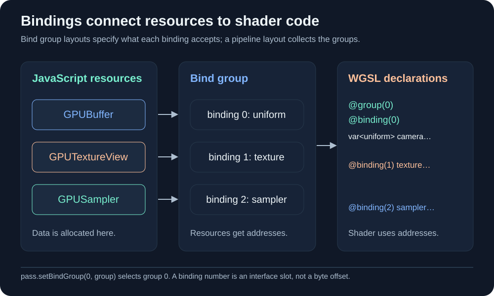

# WebGPU: explicit resources and commands

WebGPU gives JavaScript access to modern rendering and compute capabilities through explicit resources, pipelines, and command passes. The geometry and lighting math remain familiar. The way you describe and schedule work changes.

**Experiment:** [A new kind of pipeline](#/lab/webgpu-triangle). **Source:** `labs/16-webgpu-triangle.js` and `labs/webgpu.js`. **Reading bridge:** Eck §9.1; [Learn WebGPU](https://learn-webgpu.com/en) setup/triangle sequence; [WebGPU fundamentals](https://webgpufundamentals.org/webgpu/lessons/webgpu-fundamentals.html).

## Rebuild the mental model from one requested image

Suppose JavaScript wants to draw a colored triangle. Several independent facts must be specified: the destination image, the function that produces vertex positions, the function that produces colors, any data those functions read, and the command that connects them for this frame. WebGPU gives these facts explicit objects and descriptors rather than asking you to configure one large mutable context.

This does not remove setup work. In a small example it can look more verbose than WebGL. The benefit appears when many passes and resource combinations must remain compatible. A pipeline states important rendering choices together, a bind group supplies a coherent resource set, and a pass states which images are being written. Validation can compare those contracts before executing an invalid combination.

Think of a pipeline as a prepared recipe, a bind group as ingredients already packed into labeled containers, and command encoding as recording this frame's cooking steps. The analogy is useful only for ownership and compatibility: the GPU does not execute JavaScript recipes or let one invocation inspect arbitrary application objects. All shader data must still cross an explicit resource boundary.

## Capability is a result to handle

WebGPU requires a secure context, normally HTTPS or localhost. An exposed `navigator.gpu` does not guarantee a usable adapter. Check both stages:

```js
if (!navigator.gpu) throw new Error('WebGPU is not exposed');
const adapter = await navigator.gpu.requestAdapter();
if (!adapter) throw new Error('No suitable GPU adapter');
const device = await adapter.requestDevice();
```

An **adapter** describes an available implementation and its capabilities. A **device** is the interface through which you create and use resources. Optional features and higher limits must be requested when creating the device if your algorithm requires them. Request only what you need, and check support first. Avoid static browser-version promises; hardware, drivers, settings, and implementation status also matter.

The course’s native labs show a readable capability message when unavailable. They do not silently substitute a CPU or WebGL simulation and call it WebGPU. The TSL lab separately demonstrates Three.js’s fallback-capable renderer.

## Follow initialization as a chain of dependencies

The first dependency is browser exposure of the API in an appropriate context. A secure context and an exposed property are necessary, but they do not establish that an adapter can actually be obtained. The second dependency is an adapter. The third is a successfully created device. Each asynchronous step can fail and should produce a useful application state.

An `await` pauses this async function's continuation; it does not freeze all JavaScript and rendering in the browser. That allows the interface to show a loading message while device setup or pipeline compilation is pending. The course's lab mount is asynchronous for this reason. It returns its cleanup function only after its resources have been prepared successfully.

Once the device exists, canvas configuration depends on both that device and a chosen texture format. Pipeline color targets must use compatible formats with the render attachments they will write. This is why the preferred canvas format is captured in a variable and used consistently in setup instead of independently hardcoding a guessed format in several files.

There is a useful distinction between a missing feature and a programming error. No adapter is a capability outcome; it should not imply the course itself is corrupted. A mismatched attachment format is an application bug or incompatible configuration. The user-facing response can be calm and readable in both cases while developer diagnostics retain the relevant detail.

## Configure the canvas

Get a `'webgpu'` context and choose `navigator.gpu.getPreferredCanvasFormat()`. Configure it with device, format, and alpha mode. Each frame, get the current canvas texture and create a view. Do not keep a canvas texture view forever across frames or resizing; it represents a current presentation resource.

Textures own storage. Views describe which portion and interpretation of that storage a pass or binding uses. A texture can have several views when permitted, but the texture’s format, usage, dimensions, and sample count constrain them.

## Presentation resources change with the frame

The current canvas texture is a presentation resource obtained for the current work. The lab requests it inside the frame callback and immediately creates the attachment view it needs. Retaining a view from an old frame or resize can produce invalid or outdated assumptions about the destination.

Likewise, resizing the canvas is not merely a CSS operation. The drawing-buffer dimensions determine aspect and output sample count. The lab's `fitCanvas` helper updates the buffer size from the visible rectangle and a capped DPR. The uploaded aspect ratio then uses those actual dimensions. This keeps the triangle from stretching when its container changes shape.

A one-time setup pass can create stable resources such as the pipeline, bind group, and uniform buffer. The frame creates only the changing command objects and presentation view. Distinguishing stable resources from per-frame work is a foundational performance and lifecycle habit in both low-level APIs.

## Modules, pipelines, and bind groups

A shader module contains WGSL code. A render pipeline fixes a compatible shader setup, vertex layouts, primitive policy, color targets, and depth/multisample policy. A bind group supplies actual resources matching a layout. This makes many dependencies explicit rather than mutating one global context.

The triangle lab uses `layout: 'auto'` so the pipeline derives a layout from shader declarations. That is convenient for a small example. Explicit bind-group layouts support resource sharing across intentionally compatible pipelines and make larger renderer contracts clearer. Bind groups created from one auto-derived layout should not be assumed interchangeable with another pipeline’s layout merely because declarations look similar.



## Read the triangle shader as an explicit interface

The triangle lab's uniform struct stores angle, aspect, and padding. The shader declares where it expects that resource: group zero, binding zero, uniform address space. Those numbers describe a slot in the shader interface. A JavaScript bind group must provide a buffer at the corresponding binding using a compatible layout.

The vertex entry point receives `vertex_index`, a built-in integer identifying the requested vertex invocation. Because the lab draws exactly three vertices, indices zero, one, and two select its three constant position and color records. There is no position vertex buffer in this particular example. The positions are generated from constant arrays inside the shader module.

The shader rotates a selected position with sine and cosine, corrects X for aspect, and returns a struct containing clip position and color. The position output has a built-in annotation; color has a location annotation. The fragment entry point consumes the same output structure and returns one color at target location zero. Built-in annotations and ordinary locations are different interface roles even when both are expressed with `@` syntax.

This is a useful place to reconnect with the old pipeline. The vertex function still computes clip coordinates. The rasterizer still determines coverage and interpolates color. The fragment function still computes a candidate output. WebGPU's explicit command and resource model does not replace the geometry of triangles or the mathematics of interpolation.

## Trace the uniform bytes numerically

The host creates a sixteen-byte buffer and uploads four floating-point values. The first contains an angle in radians, the second the drawing-buffer aspect ratio, and the last two are padding matching the struct. For a rotation slider at ninety degrees, the uploaded first value is approximately 1.5707963. For an 800 by 400 canvas, the aspect value is 2.

At that angle, the local point `(0.75,-0.55)` rotates approximately to `(0.55,0.75)`. Dividing X by aspect gives `(0.275,0.75)` in the shader's simple clip representation with W one. This sample shows how a user-facing degree control becomes numerical data, then shader arithmetic, then screen placement. None of the pipeline objects needs to be rebuilt for this change.

The host writes a `Float32Array`, so JavaScript values are rounded into 32-bit representations before upload. The GPU interprets them according to WGSL's declared types. The next chapter explores layouts in more detail; for now, keep the four scalar positions and sixteen-byte total visible as a concrete contract.

## Immutable choices versus changing data

Changing a rotation angle should write a uniform buffer, not rebuild a pipeline. Changing target format or sample count may require a matching pipeline. Buffer usage flags declare permitted roles, such as `UNIFORM`, `VERTEX`, `STORAGE`, `COPY_DST`, or `MAP_READ`. They are not decorative hints; invalid role combinations or missing flags cause validation errors.

## Understand what pipeline creation fixes

The render-pipeline descriptor chooses the vertex and fragment entry points from the module, the target format, and triangle-list primitive topology. A later draw does not pass the shader source again. It selects this prepared pipeline and provides the remaining compatible resources and arguments.

Changing a uniform's value affects data. Changing the shader's algorithm or the fixed target format affects pipeline configuration. Treating both kinds of changes identically would waste preparation work. For example, rebuilding a pipeline every time the angle slider moves would be an unnecessarily expensive response to changing one float.

The lab uses asynchronous pipeline creation so errors can be handled through a Promise and setup need not rely on immediate synchronous compilation behavior. The shader helper separately requests compilation information and reports messages with line numbers. These stages provide useful evidence before you start changing camera matrices to diagnose a problem that was actually a syntax error.

## Encode a pass as a bounded operation

A command encoder is a recorder for commands. Beginning a render pass opens a period in which rendering commands target the declared attachments. You set the pipeline and bind group, request a draw, then end the pass. After all intended passes and copies are recorded, finishing produces a command buffer. Submitting makes that recorded work available to the device queue.

The boundaries matter. A draw belongs inside a render pass, and a compute dispatch belongs inside a compute pass. You cannot simply append a new command to a finished encoder. The explicit pass object also helps prevent accidentally continuing to draw into a target selected for a different operation earlier in the application.

For our triangle, `draw(3)` requests three vertices and uses default values for the other draw arguments. It does not mean draw three triangles. With triangle-list topology, three vertices form one triangle. In the later particle lab, `draw(6, count)` uses six vertices per instance and repeats that pair of triangles for each particle.

## Encoding one frame

Create a command encoder, begin a render pass with a color attachment, set pipeline and bind group, draw, end the pass, finish the encoder, and submit the command buffer. The lab’s central flow is:

```js
const encoder = device.createCommandEncoder();
const pass = encoder.beginRenderPass({
  colorAttachments: [{
    view: context.getCurrentTexture().createView(),
    clearValue: [0.05, 0.09, 0.13, 1],
    loadOp: 'clear', storeOp: 'store'
  }]
});
pass.setPipeline(pipeline);
pass.setBindGroup(0, group);
pass.draw(3);
pass.end();
device.queue.submit([encoder.finish()]);
```

`loadOp` chooses whether previous attachment contents are loaded or cleared. `storeOp` chooses whether results are preserved. A command encoder is used to produce a command buffer once; create new frame commands rather than trying to append forever to a finished encoder. Queue submission schedules work asynchronously.

## Load and store are data-lifetime decisions

When a pass begins, `loadOp: 'clear'` establishes a known initial value for its attachment. A later pass that intentionally builds on earlier contents may load instead. Loading data that was never meaningfully produced is a conceptual error, even if a particular implementation happens to show a stable background.

When the pass ends, `storeOp: 'store'` preserves results for presentation or later use. Some temporary attachments can be discarded when no later operation needs their contents. The exact descriptor policy follows the pass graph's dependencies. Choosing load/store operations is therefore a declaration about information flow, not just a pair of mandatory words to copy from an example.

Depth and multisampling add further attachment compatibility requirements. Keep the first triangle free of them so the color path is understandable. The textured cube later adds depth as one explicit extension, showing which descriptor fields and resources change while the basic command flow remains the same.

## Validation and lifetime

Use shader compilation information, descriptive labels, error scopes around operations you want to handle, and an `uncapturederror` handler for diagnostics. Device loss uses the Promise property `device.lost.then(...)`, not a function call. If a device is lost, stop the old loop and recreate the resources on a new device as appropriate. A resource from the old device cannot simply be reused on the new one.

The small labs destroy their device on teardown because each owns its device exclusively. A production application may share a device across scenes and should destroy only resources owned by the departing scene. Resource ownership is an application-level design decision.

## Resource cleanup and device ownership

Labels on resources are worth adding as examples grow. A message identifying a scene uniform buffer or particle output buffer is easier to investigate than one referring to an anonymous handle. Labels do not change shader semantics; they improve the evidence available when a resource contract fails.

The lab owns an entire device for its isolated demonstration. Its cleanup stops the frame loop, destroys the uniform buffer, unconfigures the canvas, and destroys the device. A larger application may instead own one shared device and reuse it across many scenes. In that design, an individual scene must not destroy the shared device when it exits.

Always decide ownership before adding cleanup calls. Destroying a resource too early can invalidate pending or future work; never destroying owned resources can cause growth as users navigate. An asynchronous mount can finish after the route has changed, so the surrounding application needs a generation or cancellation policy. The course's route handler disposes such late results rather than attaching them to an unrelated page.

**Optional application:** compare this frame encoding with the raw WebGL triangle. List which choices are now pipeline descriptors, which are bind-group resources, and which remain per-frame command arguments. The purpose is to translate the model, not memorize a second pile of API names.
